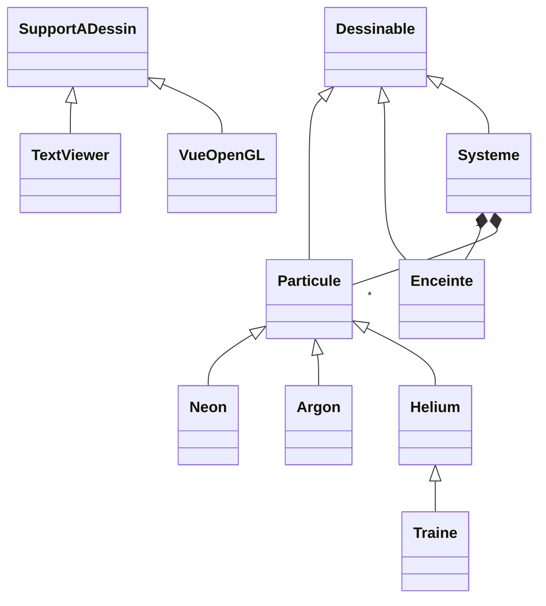

# Gas Particle Simulation

A C++17 simulation of a monatomic gas (helium, neon and argon atoms in a 3D box) with a real-time Qt/OpenGL view and a text mode. Paul Vidal and I wrote it for the Object-Oriented Programming course (CS-112) at EPFL in spring 2024.

## What it simulates

The 3D version shows 999 atoms, 333 of each gas, in a 100 × 100 × 100 box, plus one helium *tracer* atom. The tracer leaves a trail behind it, which shows its Brownian motion as the other atoms knock it around.

**Initial state.** Positions are uniform in the box. Velocities follow the Maxwell–Boltzmann distribution at 293.15 K: each component is drawn from a normal distribution of variance $RT/M$, where $M$ is the molar mass of the gas. Helium atoms therefore move about three times faster than argon atoms.

**Each time step** $\Delta t$:

1. **Free flight.** Every atom moves in a straight line: $\mathbf x \leftarrow \mathbf x + \mathbf v \Delta t$.
2. **Walls.** An atom that crossed a wall is reflected back inside, and the matching velocity component changes sign.
3. **Collisions.** Atoms that share a unit cell of the box collide. Let $\mathbf v_g$ be the velocity of their centre of mass. In that frame, atom 2's velocity keeps its norm but takes a uniformly random direction $\mathbf v_0$, and atom 1's velocity follows from momentum conservation:

$$\mathbf v_g = \frac{m_1 \mathbf v_1 + m_2 \mathbf v_2}{m_1 + m_2}$$

$$\mathbf v_2' = \mathbf v_g + \mathbf v_0, \qquad \mathbf v_1' = \mathbf v_g - \frac{m_2}{m_1} \mathbf v_0$$

where $\mathbf v_0$ has the same norm as $\mathbf v_2 - \mathbf v_g$.

Each collision conserves momentum and kinetic energy.

**Two ways to find collisions.** `Systeme::evolue1` tests every pair of atoms and makes those closer than a distance ε collide, in $O(n^2)$. `Systeme::evolue2` sorts the atoms into the unit cells of the box and only pairs atoms within a cell, in $O(n)$. The 3D view uses `evolue2`.

## Design



- **`Particule`** is abstract. Each gas is a subclass, and `Traine` is a helium atom that also records its past positions. `Systeme` stores the atoms through base-class pointers and copies them with a virtual `copie()` method.
- **Drawing uses double dispatch.** Everything that can be drawn derives from `Dessinable`, and each surface it can be drawn on derives from `SupportADessin`. An object's `dessine_sur(support)` calls `support.dessine(*this)`, so the code that runs depends on both the object's type and the surface's type. That is how the same simulation is printed by `TextViewer` or rendered by `VueOpenGL` without either knowing about the other.

## Build and run

### Text version

Any C++17 compiler; no Qt needed. It runs ten steps with three atoms in a 20 × 20 × 20 box and prints every bounce and collision.

```sh
g++ -std=c++17 -O2 -Icore core/*.cc text/*.cc -o gas_text
./gas_text
```

### 3D version

It needs Qt 5 or Qt 6. Running `qmake` at the top level builds both programs.

```sh
# macOS
brew install qt@5
$(brew --prefix qt@5)/bin/qmake && make
./gl/gas_gl

# Ubuntu / Debian
sudo apt install qtbase5-dev libgl-dev
qmake && make
./gl/gas_gl
```

| Keys | Action |
|---|---|
| Arrow keys | Rotate the view |
| W / S (or Page Up / Page Down) | Move forward / back |
| A / D | Move left / right |
| R / F | Move up / down |
| Q / E | Roll |
| Home | Reset the view |
| Space | Pause |

The random seed is fixed, so every run starts from the same state. To change it, pass another seed as the last argument of the `Systeme` constructor.

## Code

| Folder | Contents |
|---|---|
| [`core/`](core) | The simulation: `Vecteur3D`, `Particule` and its subclasses, `Enceinte` (the box), `Systeme` (time evolution and collisions), and the drawing interfaces |
| [`text/`](text) | `TextViewer` and the terminal demo |
| [`gl/`](gl) | The Qt window (`GLWidget`: timer and keyboard), the OpenGL drawing (`VueOpenGL`, `GLSphere`) and the shaders |

Class and method names are in French, the language of the course:

| In the code | Meaning |
|---|---|
| `particule`, `enceinte`, `systeme` | particle, box, system |
| `vitesse`, `masse` | velocity, mass |
| `evolue` | advance by one time step |
| `choc_parois` | bounces on the walls |
| `tirer_pos`, `tirer_vit` | draw a random position, velocity |
| `dessine_sur`, `SupportADessin` | draw on, drawing surface |
| `traine` | trail |
| `cellules` | grid cells |

## History

The first commit is the version we submitted in June 2024. The later commits reorganise the folders, fix bugs found while reviewing the code, and translate the comments into English. The largest fix concerns memory: the collision grid of the original used about 670 MB for 1,000 atoms, and now uses about 33 MB. Each commit message lists what changed.

## Credits

Written by Paul Vidal and Pierre Levilion for CS-112 *Programmation orientée objet* (Prof. Jean-Cédric Chappelier), EPFL, spring 2024, and shared with the agreement of the course instructor.

The course provided the OpenGL scaffolding (the window and camera code in `GLWidget` and `VueOpenGL`, `GLSphere` and the shaders) and the random number generator (`GenerateurAleatoire`). The overall structure and the physical model follow the course's weekly instructions. We wrote the particle and system classes, the collision methods, the trail and the drawing of the simulation.
